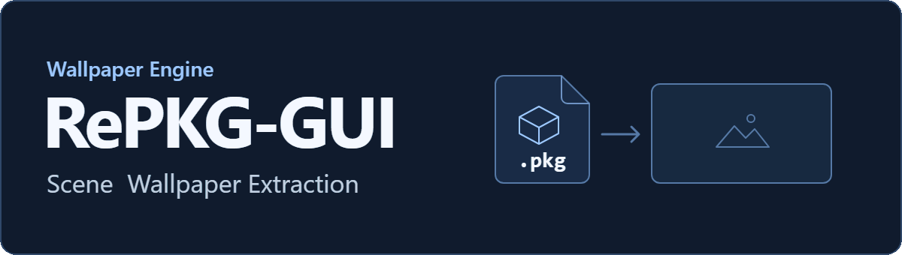
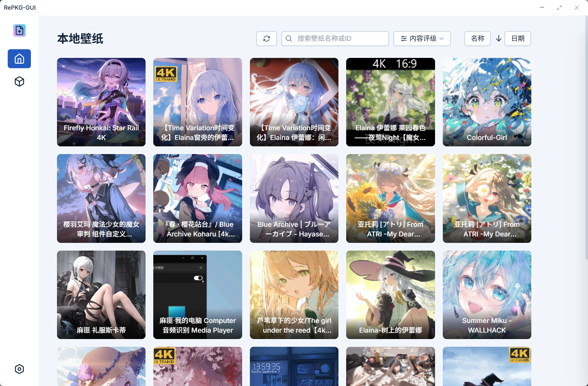

<h1></h1>

在 Windows 上浏览 Steam 创意工坊壁纸、批量提取场景 `.pkg`，或把场景导入 Wallpaper Engine 编辑器继续编辑。

**[下载 Windows 安装包](https://github.com/NaiHeeeee/repkg-gui/releases)** · [快速上手](#快速上手) · [English](./README_en.md)

<picture>
  <source media="(prefers-color-scheme: dark)" srcset="./assets/readme/library-dark-cn.webp">
  
</picture>

## 快速上手

1. 打开 [GitHub Releases](https://github.com/NaiHeeeee/repkg-gui/releases)，下载 Windows x64 的 `.exe` 安装包并启动应用。
2. 在 **本地壁纸** 中选择已下载的场景壁纸。列表为空时，在设置中检查 Steam 创意工坊路径（Steam 库下的 `steamapps/workshop/content/431960`）。
3. 打开壁纸详情，点击 **开始提取** 保存资源，或选择 **导入壁纸编辑器** 继续编辑。

如果手上已有 `.pkg` 文件，直接进入 **手动提取**，选择一个或多个文件，确认输出目录后点击 **开始提取**。完成后可直接打开提取文件夹。

## 功能与设置

- **浏览本地壁纸** · 自动扫描创意工坊目录，按名称或 ID 搜索，查看缩略图与详情。
- **控制提取结果** · 可仅提取图片、保留原始 `.tex`，也可设置文件是否按壁纸分目录以及是否覆盖同名文件。
- **自定义界面** · 支持亮色、暗色和跟随系统，提供简体中文、繁體中文、English 和日本語，可设置背景与透明度。

<details>
<summary>从源码运行</summary>

在 Windows 上准备 Rust stable、Node.js 22+、pnpm 和 [Tauri 的 Windows 开发依赖](https://v2.tauri.app/start/prerequisites/#windows)。

```sh
git clone https://github.com/NaiHeeeee/repkg-gui.git
cd repkg-gui
pnpm install
pnpm tauri dev --config src-tauri/tauri-dev.conf.json
```

使用 `pnpm run tauri:build` 构建安装包，或用 `pnpm run cmd` 打开开发命令菜单。

</details>

## 许可证与致谢

本项目采用 [MIT 许可证](./LICENSE)。资源提取由 [RePKG](https://github.com/notscuffed/repkg) 提供支持，桌面应用基于 [Tauri](https://tauri.app/) 构建。
