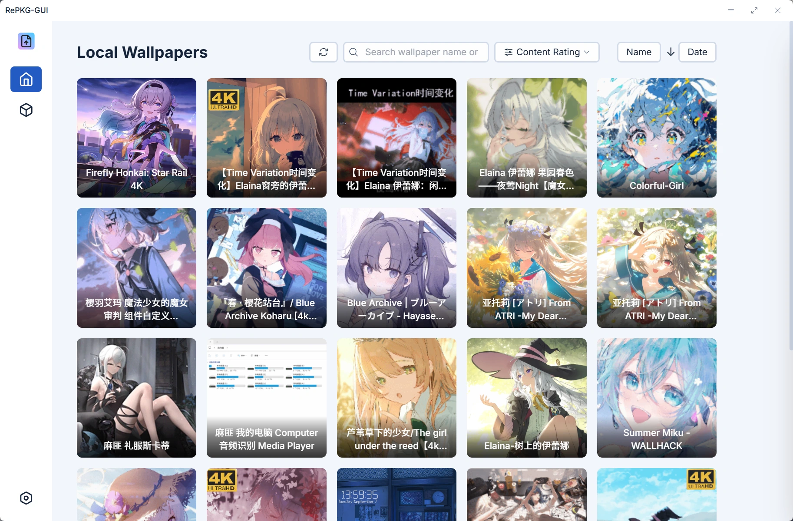

<h1></h1>

Browse your Steam Workshop wallpapers, batch-extract scene `.pkg` files, or import a scene into the Wallpaper Engine editor on Windows.

**[Download for Windows](https://github.com/NaiHeeeee/repkg-gui/releases)** · [Quick start](#quick-start) · [简体中文](./README.md)

<picture>
  <source media="(prefers-color-scheme: dark)" srcset="./assets/readme/library-dark-en.webp">
  
</picture>

## Quick start

1. Download the Windows x64 `.exe` installer from [GitHub Releases](https://github.com/NaiHeeeee/repkg-gui/releases) and launch the app.
2. Pick a downloaded scene under **Local Wallpapers**. If the list is empty, check the Steam Workshop path in Settings (`steamapps/workshop/content/431960` under your Steam library).
3. Open the wallpaper details and start extraction, or import the scene into the Wallpaper Engine editor to keep editing.

If you already have `.pkg` files, open **Manual Extract**. Select one or more files, choose the destination, and start extraction. You can open the output folder when it finishes.

## Features and settings

- **Browse local wallpapers** · Scan your Workshop folder, search by title or ID, and view thumbnails and details.
- **Control extraction** · Extract images only, keep the original `.tex` files, or choose how to group outputs and handle files with the same name.
- **Customize the interface** · Choose a light, dark, or system theme. The app supports English, Simplified Chinese, Traditional Chinese, and Japanese, with a customizable background and opacity.

<details>
<summary>Run from source</summary>

On Windows, install Rust stable, Node.js 22+, pnpm, and the [Tauri Windows prerequisites](https://v2.tauri.app/start/prerequisites/#windows).

```sh
git clone https://github.com/NaiHeeeee/repkg-gui.git
cd repkg-gui
pnpm install
pnpm tauri dev --config src-tauri/tauri-dev.conf.json
```

Use `pnpm run tauri:build` to build an installer or `pnpm run cmd` to open the development command menu.

</details>

## License and credits

Released under the [MIT license](./LICENSE). Extraction is powered by [RePKG](https://github.com/notscuffed/repkg), and the desktop app is built with [Tauri](https://tauri.app/).
